  

<a href="https://johnportifolio.rjaybarber.shop"><strong>Portfolio</strong></a> · <a href="https://johnportifolio.rjaybarber.shop/experience">Experience</a> · <a href="https://www.linkedin.com/in/ruhumbika-mtumba-john">LinkedIn</a>

I build business applications and connect systems through APIs, background workers and workflow automation. I work at **Abood Group** and lead **RJAY Digital Hub**.

### Project portfolio

#### Abood Group

| Project | My contribution |
| :--- | :--- |
| [Abood Media Radio Studio Gateway](https://johnportifolio.rjaybarber.shop/projects/abood-radio-studio-gateway) | Connected ERP ad schedules to RadioBOSS playback and advert insertion. |
| [Biometric Attendance & GHRM Integration](https://johnportifolio.rjaybarber.shop/projects/ghrm-attendance-bridge) | Built the bridge that filters, queues and forwards attendance records from EasyTimePro and ZKTeco to GHRM. |
| [Attendance Core](https://johnportifolio.rjaybarber.shop/projects/attendance-core-dashboard) | Deployed supporting services and implemented attendance event forwarding to GHRM. |
| [WhatsApp ERP Approval Gateway](https://johnportifolio.rjaybarber.shop/projects/whatsapp-approval-gateway) | Built the gateway and webhook flows for interactive approvals, ERP callbacks and auditing. |
| [Abood Bus WhatsApp Ticketing Bot](https://johnportifolio.rjaybarber.shop/experience) | Diagnosed booking faults and maintained the bot used for daily ticketing. |
| [PETA Holdings ERP Dashboard](https://johnportifolio.rjaybarber.shop/projects/peta-holdings-erp) | Developed ERP dashboard features for property, lease and revenue operations. |

#### Client and independent projects

| Project | My contribution |
| :--- | :--- |
| [RJAY Barbershop Booking Platform](https://johnportifolio.rjaybarber.shop/projects/rjay-barbershop) | Built and deployed customer booking, appointment scheduling and administration features. |
| [RJAY WiFi Platform](https://johnportifolio.rjaybarber.shop/projects/rjay-wifi-platform) | Developed customer and administration interfaces for voucher-based WiFi access. |
| [Eagersky Real Estate Platform](https://johnportifolio.rjaybarber.shop/projects/eagersky) | Worked on property discovery, listings and booking request workflows. |
| [Mobile-First Rental Platform (MVP)](https://johnportifolio.rjaybarber.shop/projects/rental-platform) | Designed the MVP around property discovery, listings and tenant and landlord workflows. |
| [Software Engineering Portfolio](https://github.com/Ruhumbika/PORTFOLIO) | Built a Next.js site for engineering case studies and professional experience. |

#### Public service and university projects

| Project | My contribution |
| :--- | :--- |
| [Kilindi Traders Digital Licence Management System](https://johnportifolio.rjaybarber.shop/experience) | Developed and deployed features for trader registration, licence renewals, SMS reminders and reporting. |
| [Student Support LLM Platform](https://johnportifolio.rjaybarber.shop/projects/student-support-llm) | Built a Python API and retrieval workflow that answers student questions from an FAQ knowledge base. |
| [UDSM Startup Portal](https://github.com/Ruhumbika/udsm-startup-incubator) | Led the academic team and developed the portal homepage. |

### Technology stack

<picture>
  <source media="(prefers-color-scheme: dark)" srcset="assets/readme/stack-dark.svg">
  
</picture>

### GitHub contributions

<picture>
  <source media="(prefers-color-scheme: dark)" srcset="https://raw.githubusercontent.com/Ruhumbika/Ruhumbika/profile-activity/assets/readme/contributions-dark.svg">
  
</picture>
