  

<a href="https://johnportifolio.rjaybarber.shop"><strong>Portfolio</strong></a> · <a href="https://johnportifolio.rjaybarber.shop/experience">Experience</a> · <a href="https://www.linkedin.com/in/ruhumbika-mtumba-john">LinkedIn</a>

I build business applications and connect systems through APIs, background workers and workflow automation. I work at **Abood Group** and lead **RJAY Digital Hub**.

### Selected work

| Project | What I worked on |
| :--- | :--- |
| [WhatsApp Approval Gateway](https://johnportifolio.rjaybarber.shop/projects/whatsapp-approval-gateway) | ERP approval workflows that send WhatsApp decisions back to the originating system. |
| [Abood Radio Studio Gateway](https://johnportifolio.rjaybarber.shop/projects/abood-radio-studio-gateway) | Integration between an ERP scheduling system and RadioBOSS in the studio. |
| [RJAY WiFi Platform](https://johnportifolio.rjaybarber.shop/projects/rjay-wifi-platform) | Customer and administration interfaces for a WiFi service platform. |
| [Portfolio](https://github.com/Ruhumbika/PORTFOLIO) | A Next.js site for my experience and projects. |
| [UDSM Startup Portal](https://github.com/Ruhumbika/udsm-startup-incubator) | Academic team leadership and homepage development. |

### Technology stack

<picture>
  <source media="(prefers-color-scheme: dark)" srcset="assets/readme/stack-dark.svg">
  
</picture>

### GitHub contributions

<picture>
  <source media="(prefers-color-scheme: dark)" srcset="https://raw.githubusercontent.com/Ruhumbika/Ruhumbika/profile-activity/assets/readme/contributions-dark.svg">
  
</picture>
