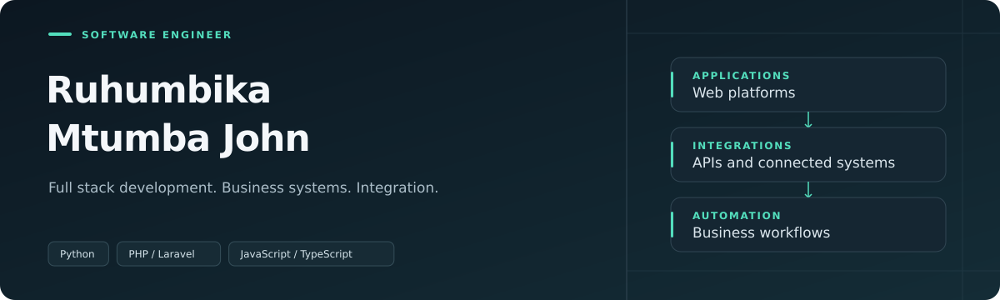

<a href="https://johnportifolio.rjaybarber.shop"><strong>Portfolio</strong></a> · <a href="https://johnportifolio.rjaybarber.shop/experience">Experience</a> · <a href="https://www.linkedin.com/in/ruhumbika-mtumba-john">LinkedIn</a>

I am a software engineer working across full stack development, business applications and workflow automation. I work at **Abood Group** and lead **RJAY Digital Hub**.

### Selected work

| Project | Contribution |
| :--- | :--- |
| [Business approval software](https://johnportifolio.rjaybarber.shop/projects/whatsapp-approval-gateway) | Application development and workflow automation. |
| [Media software](https://johnportifolio.rjaybarber.shop/projects/abood-radio-studio-gateway) | Software integration and operational support. |
| [WiFi service platform](https://johnportifolio.rjaybarber.shop/projects/mwanakitaa-kitonga-wifi) | Customer and administration interfaces. |
| [Portfolio](https://github.com/Ruhumbika/PORTFOLIO) | Professional project presentation with Next.js. |
| [UDSM Startup Portal](https://github.com/Ruhumbika/udsm-startup-incubator) | Academic team leadership and homepage development. |

**Core stack:** Python · PHP / Laravel · JavaScript / TypeScript · Vue · Next.js
